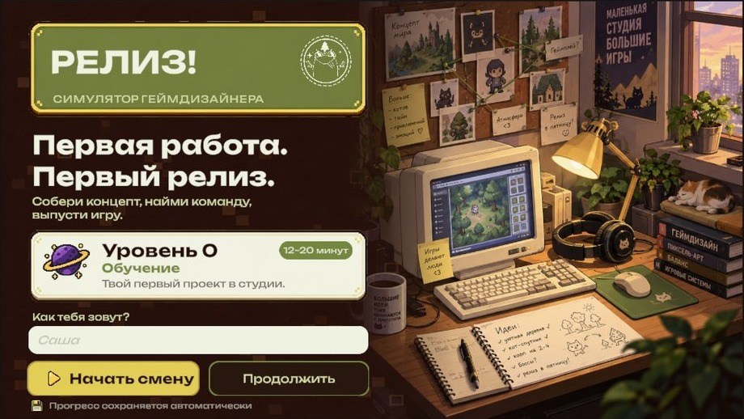
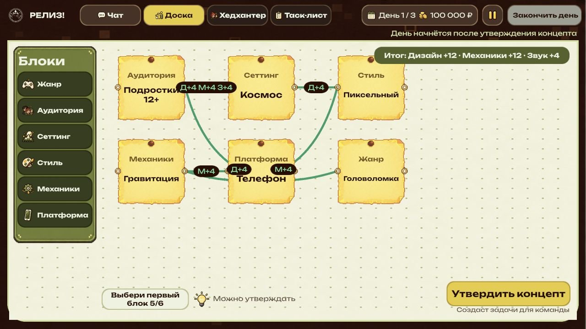
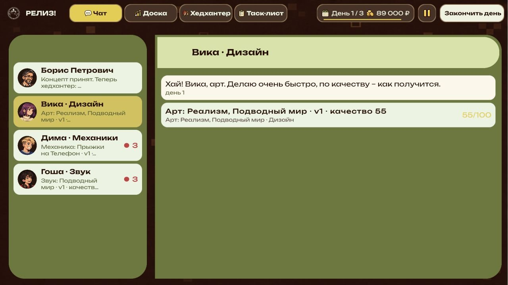
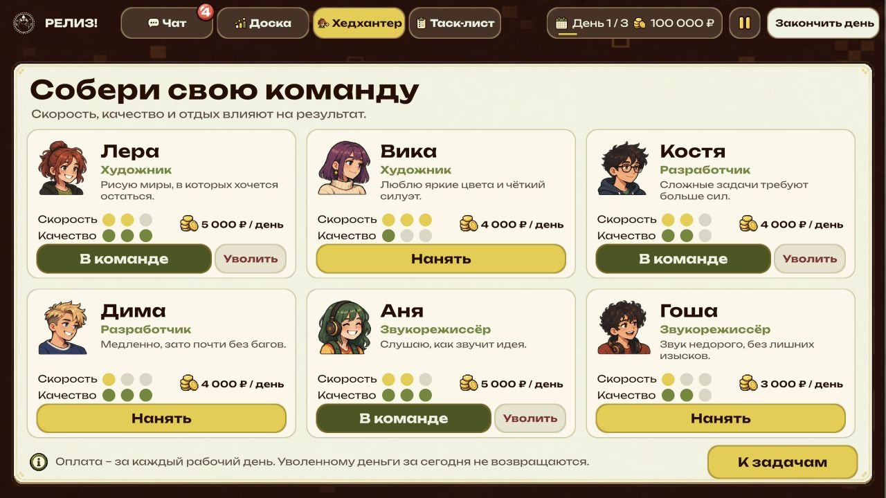
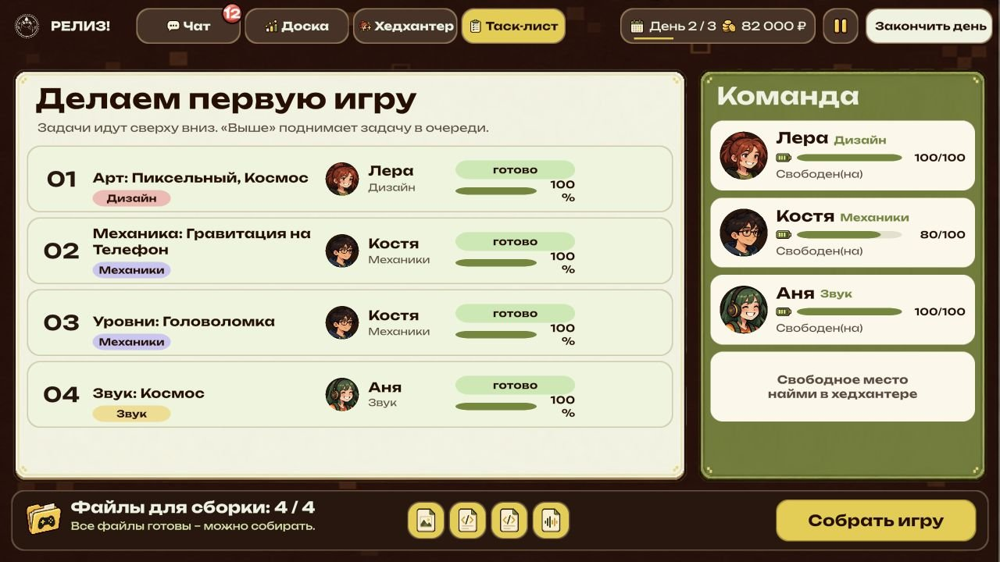
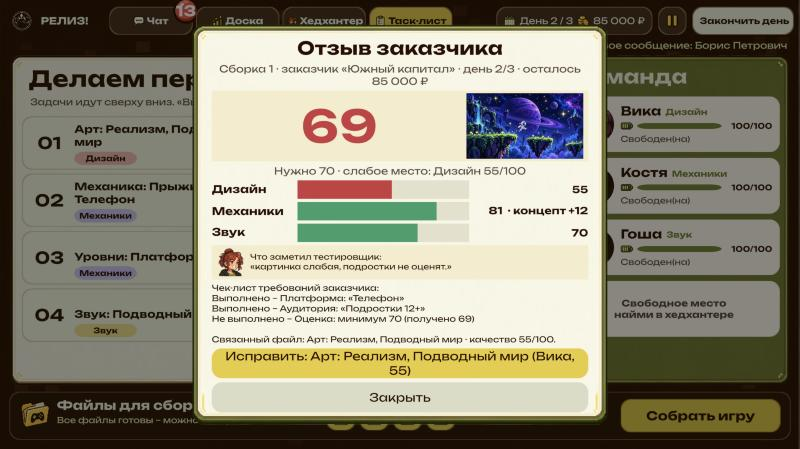
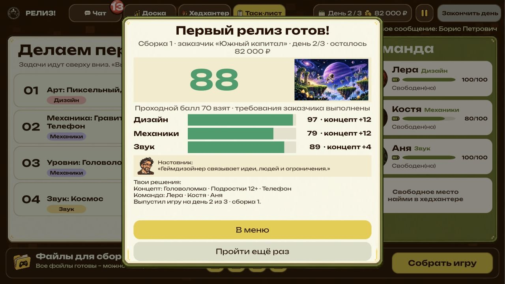

<div align="center">


# РЕЛИЗ!

**Симулятор геймдизайнера. Первая работа, первый релиз.**

[](https://fuheshka.github.io/centrinvest-profession-game/)

-111827?style=flat-square&logo=unity)

-0f766e?style=flat-square)


[О чём игра](#о-чём-игра) · [Игровой цикл](#игровой-цикл) · [Скриншоты](#что-внутри) · [Архитектура](#архитектура-и-стек) · [Сборка](#сборка-и-запуск) · [Команда](#команда)

<br>



</div>

---

## О чём игра

Ты стажёр в небольшой игровой студии. Руководитель Борис присылает заказ от банка: сделать игру для подростков, за три дня и сто тысяч рублей. Дальше всё как в настоящей разработке: нужно собрать концепт, нанять людей, распределить задачи, следить за усталостью и вовремя выпустить сборку.

Игра не про «придумай красивую идею», а про последствия решений:

- Выбрал жанр, который конфликтует с аудиторией – команда потом расхлёбывает это на производстве.
- Нанял дешёвого звуковика – качество итогового файла просело.
- Забыл про энергию – сотрудник выпадает из работы на день, а дедлайн никуда не двигается.

Проект сделан под кейс хакатона банка **«Центр-инвест»**: браузерная игра без регистрации, в которой подросток до 16 лет пробует профессию геймдизайнера изнутри. Требования кейса и критерии оценки разобраны в [docs/CASE.md](docs/CASE.md).

---

## Игровой цикл

```text
[1. ТЗ в чате] ──▶ [2. Доска концепта] ──▶ [3. Найм и таск-лист] ──▶ [4. Сборка и отзыв]
                         ▲                                                   │
                         └─────── доработка файла или пересмотр концепта ────┘
```

### Как играть

1. Открой [страницу игры](https://fuheshka.github.io/centrinvest-profession-game/), введи имя и нажми **«Начать смену»** (регистрация не нужна).
2. Прочитай ТЗ в чате у Бориса.
3. На доске собери концепт: поставь блоки, выбери в каждом параметр и соедини их линиями. Зелёная линия означает, что сочетание усиливает игру.
4. В хедхантере (**ШиШ.ру**) найми специалистов по дизайну, механикам и звуку. У каждого свои скорость, качество и ставка за день.
5. В таск-листе назначь задачи и следи за энергией: уставший сотрудник работает хуже или уходит отдыхать.
6. Нажми **«Собрать игру»**. Заказчик оценит звук, дизайн и механики. Если оценка ниже порога – отдай слабый файл на доработку или пересмотри концепт и собери заново.

Прогресс сохраняется автоматически (IndexedDB / `PlayerPrefs`), пауза и настройки – по клавише `Esc`.

---

## Что внутри

| Доска концепта | Мессенджер («Жабаграм») |
|:---:|:---:|
| <br><sub>Стикеры с параметрами и связи между блоками</sub> | <br><sub>ТЗ, события студии и сдача готовых файлов</sub> |

| Найм команды («ШиШ.ру») | Таск-лист и лоток сборки |
|:---:|:---:|
| <br><sub>Шесть кандидатов с характеристиками и ставкой</sub> | <br><sub>Очередь задач, энергия команды и файлы сборки</sub> |

| Отзыв заказчика | Итог и релиз |
|:---:|:---:|
| <br><sub>Оценка по трём осям и разбор слабого места</sub> | <br><sub>Обложка проекта, решения и остаток бюджета</sub> |

- **Чат.** Борис и нанятые сотрудники пишут в реальном времени, присылают готовые файлы и события студии, где выбор ответа влияет на энергию, время и бюджет.
- **Доска.** Свободный холст концепта: 22 проверенных набора сочетаний, подсчёт плюсов и минусов, автоматическая генерация задач.
- **Хедхантер.** Шесть кандидатов с характером, скоростью, качеством и дневной ставкой.
- **Таск-лист.** Распределение задач, приоритеты, контроль усталости, доработка файлов и сборка релизной версии.

Подробные правила и баланс уровня 0: [docs/MVP_RULES.md](docs/MVP_RULES.md).

---

## Архитектура и стек

| Слой | Технологии и решения |
|---|---|
| Движок | Unity 6 (`Universal 2D`, URP) |
| Платформа | WebGL (`Brotli`, Decompression Fallback, Data Caching) |
| Язык и сборка | C#, раздельные asmdef: `Studio.Core`, `Studio.UI`, `Studio.Tests.EditMode` |
| Интерфейс | TextMeshPro, префабы в сценах `Menu` и `Game`, корутины движения без сторонних tween-пакетов |
| Тестирование | NUnit EditMode (правила концепта, симуляция дня, маршруты уровня 0, сохранение) |
| Хостинг | GitHub Pages (ветка `gh-pages` через [tools/deploy_pages.sh](tools/deploy_pages.sh)) |

Логика правил полностью изолирована от интерфейса в `Assets/_Project/Scripts/Core`, поэтому все игровые маршруты и расчёты проверяются модульными тестами без запуска сцены. Весь UI собран на префабах – внешний вид редактируется в Unity Editor без правки кода.

<details>
<summary>Структура репозитория</summary>

```text
centrinvest-profession-game/
├── Assets/_Project/
│   ├── Art/                 # UI-кит, стикеры, аватарки, логотип и шрифты
│   ├── Data/                # ScriptableObjects: Level0, Level1 и тестовые базы
│   ├── Editor/              # Генераторы UI-префабов, Level0Builder, WebRelease
│   ├── Prefabs/UI/          # Префабы экранов (Common, Menu, Messenger, Board, Mvp, Kit)
│   ├── Resources/           # Музыка, SFX и PixelTransition
│   ├── Scenes/              # Menu.unity (индекс 0) и Game.unity
│   ├── Scripts/
│   │   ├── Core/            # Studio.Core: Data, State, Systems (без зависимостей от UI)
│   │   └── UI/              # Studio.UI: Common, Menu, Messenger, Board, Versions, Mvp
│   └── Tests/EditMode/      # Studio.Tests.EditMode: Core, Board, Level0, Review, Versions
├── docs/                    # GDD, CASE, STATE, DEVLOG, BUGS, мокапы и прогресс
└── tools/                   # Скрипты скриншотов прогресса (progress.py) и деплоя (deploy_pages.sh)
```

</details>

---

## Сборка и запуск

Требуется **Unity 6** (модуль **WebGL Build Support** для веб-сборки).

1. Клонируй репозиторий и открой папку в Unity Hub:
   ```bash
   git clone https://github.com/Fuheshka/centrinvest-profession-game.git
   ```
2. Открой сцену `Assets/_Project/Scenes/Menu.unity` (индекс `0`) и нажми **Play**.
3. Для запуска тестов в редакторе: `Window > General > Test Runner > EditMode > Run All` (или фильтр `Studio.Tests`).
4. Для веб-сборки и локального запуска:
   - в Unity выбери `Tools > Build Web Release` (результат попадёт в `Builds/Web`);
   - подними локальный сервер:
     ```bash
     cd Builds/Web && python3 -m http.server
     ```
   - публикация на GitHub Pages: `./tools/deploy_pages.sh`.

---

## Команда

<div align="center">

</div>

| Участник | Роль в проекте |
|---|---|
| **Даниил Кувико ([Fuheshka](https://github.com/Fuheshka))** | **Team Lead, архитектура, программирование, интеграция и визуал** |
| Яна Скарнович | Дизайн, презентация |
| Данил Устенко | Нарратив, тексты |
| Ева Николаева | UI/UX-дизайн |
| Константин Михайлов | Программирование |
| Кирилл Кирянчев | Саунд-дизайн |

Правила владения папками и работы с ветками описаны в [docs/TEAM.md](docs/TEAM.md).

---

## Документы проекта

| Файл | Содержание |
|---|---|
| [docs/CASE.md](docs/CASE.md) | Требования кейса «Центр-инвест» и критерии оценки |
| [docs/GDD.md](docs/GDD.md) | Дизайн-документ игры «РЕЛИЗ!» |
| [docs/DEMO.md](docs/DEMO.md) | Скоуп демо-версии и учебного уровня |
| [docs/MVP_RULES.md](docs/MVP_RULES.md) | Правила, числа баланса и расчётные маршруты |
| [docs/STATE.md](docs/STATE.md) | Текущее состояние разработки |
| [docs/BUGS.md](docs/BUGS.md) | Открытые задачи, дефекты и журнал исправлений |
| [docs/DEVLOG.md](docs/DEVLOG.md) | Хронологический журнал разработки |
| [docs/ROADMAP.md](docs/ROADMAP.md) | Архитектурные контракты и вехи |

---

## Участие и обратная связь

- Нашёл баг или есть идея по улучшению уровня – оформи issue через шаблоны в [.github/ISSUE_TEMPLATE](.github/ISSUE_TEMPLATE).
- Для изменений в коде делай ветку от `dev` (например, `feat/short-name` или `fix/short-name`), проверяй тесты EditMode и открывай PR в `dev` по [шаблону PR](.github/pull_request_template.md).
