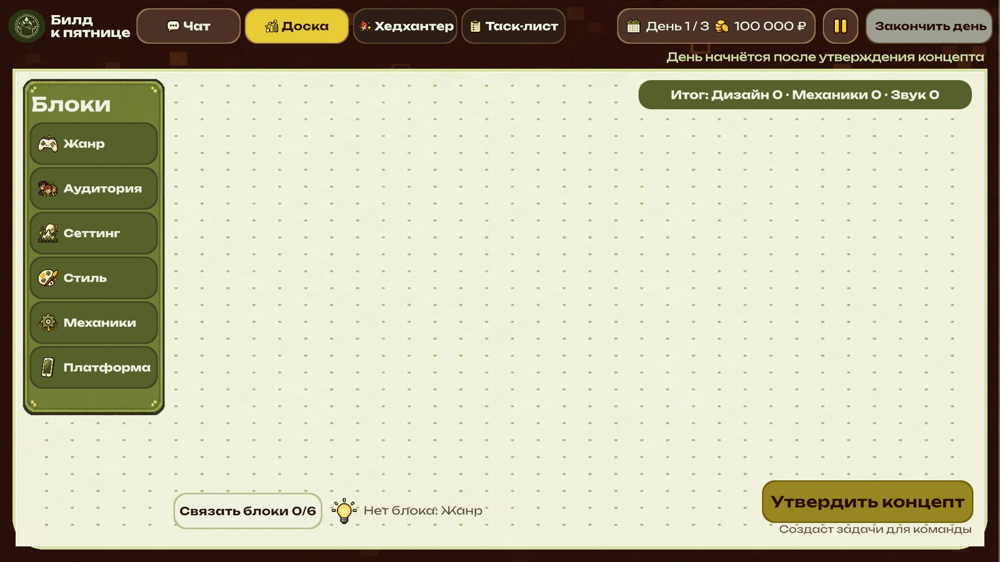
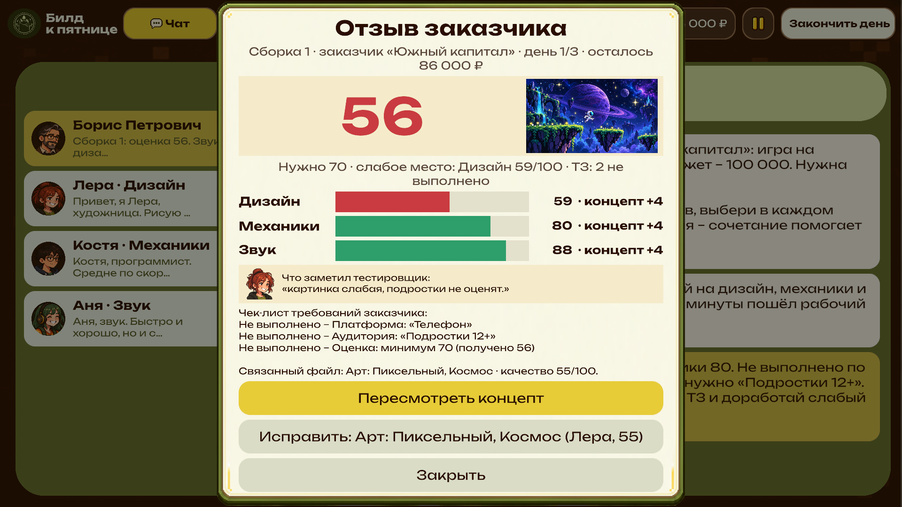
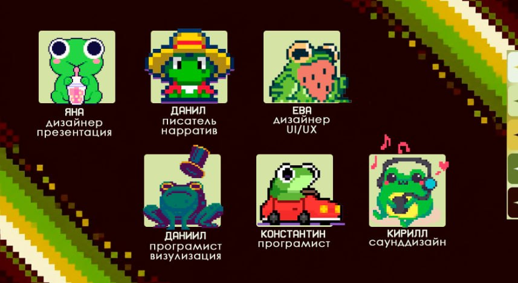

<div align="center">


# РЕЛИЗ!

**Симулятор геймдизайнера. Первая работа, первый релиз.**

[Играть в браузере](https://fuheshka.github.io/centrinvest-profession-game/) · [Правила кейса](docs/CASE.md) · [Дизайн-документ](docs/GDD.md)


</div>

## О чём игра

Ты стажёр в небольшой студии. Руководитель Борис присылает заказ от банка: сделать игру для подростков, за три дня и сто тысяч рублей. Дальше всё как в настоящей работе: надо придумать концепт, нанять людей, раздать задачи и вовремя выпустить игру.

Игра не про «придумай идею», а про решения. Выбрал жанр, который не сочетается с аудиторией, и команда потом это расхлёбывает. Нанял дешёвого звуковика, и качество файла просело. Не уследил за усталостью, и человек выпал на день.

Игра для школьников, которые выбирают профессию: так проще понять, чем геймдизайнер занят целый день, чем из описания на сайте.

Хакатон банка «Центр-инвест»: браузерная игра, в которой подросток до 16 лет пробует одну профессию. Требования кейса разобраны в [docs/CASE.md](docs/CASE.md).

## Как играть

1. Открой [страницу игры](https://fuheshka.github.io/centrinvest-profession-game/), введи имя и нажми «Начать смену». Регистрация не нужна.
2. Прочитай ТЗ в чате у Бориса.
3. На доске собери концепт: поставь блоки, выбери в каждом параметр и соедини их линиями. Зелёная линия значит, что сочетание работает на игру.
4. В хедхантере найми людей: дизайн, механики и звук. У каждого свои скорость, качество и ставка за день.
5. В таск-листе раздай задачи. Следи за энергией: уставший работает хуже.
6. Нажми «Собрать игру». Заказчик оценит звук, дизайн и механики. Если не дотянул до нужного балла, можно поправить слабое место и собрать снова.

Прогресс сохраняется сам. Пауза на `Esc`.

## Что внутри

<table>
<tr>
<td width="50%"><br><sub>Доска концепта: блоки на стикерах и связи между ними</sub></td>
<td width="50%"><br><sub>Отзыв заказчика после сборки</sub></td>
</tr>
</table>

- **Чат.** Борис и нанятые сотрудники пишут тебе сообщения, иногда с проблемами, которые надо решить.
- **Доска.** Свободный холст концепта. Сочетания блоков дают плюсы и минусы, а сам концепт порождает задачи.
- **Хедхантер.** Шесть кандидатов с характером и ценой.
- **Таск-лист.** Задачи, исполнители, прогресс, сборка игры.

Подробные правила и числа: [docs/MVP_RULES.md](docs/MVP_RULES.md).

## Сборка и запуск

Нужен Unity 6 (Universal 2D). Открой папку проекта в Unity Hub.

- Сцена меню: `Assets/_Project/Scenes/Menu.unity` (индекс 0), игра: `Game.unity`.
- Веб-сборка: меню `Tools > Build Web Release`, результат в `Builds/Web`.
- Локально посмотреть сборку:

```bash
cd Builds/Web && python3 -m http.server
```

- Тесты: Window > General > Test Runner > EditMode > Run All.
- Публикация на GitHub Pages: `tools/deploy_pages.sh` кладёт готовую сборку в ветку `gh-pages`.

## Стек

| Что | Чем |
|---|---|
| Движок | Unity 6, Universal 2D |
| Платформа | WebGL (Brotli, Decompression Fallback) |
| Язык | C# |
| Тесты | NUnit, EditMode |
| Интерфейс | TextMeshPro, префабы в сценах |
| Хостинг | GitHub Pages |

Логика правил живёт отдельно от интерфейса (`Assets/_Project/Scripts/Core`), поэтому её можно тестировать без запуска игры. Интерфейс собран в сценах и префабах, и художник может поправить внешний вид, не трогая код.

## Команда



| Кто | Роль |
|---|---|
| Яна | дизайнер, презентация |
| Данил | писатель, нарратив |
| Ева | дизайнер UI/UX |
| Даниил | программист, визуализация |
| Константин | программист |
| Кирилл | саунд-дизайн |

Кто за какие папки отвечает в коде и как мы работаем с git: [docs/TEAM.md](docs/TEAM.md).

## Документы

| Файл | Что там |
|---|---|
| [docs/CASE.md](docs/CASE.md) | требования кейса и критерии оценки |
| [docs/GDD.md](docs/GDD.md) | дизайн-документ игры |
| [docs/DEMO.md](docs/DEMO.md) | что входит в демо-версию |
| [docs/STATE.md](docs/STATE.md) | где остановились и что делать дальше |
| [docs/BUGS.md](docs/BUGS.md) | открытые баги и вопросы |
| [docs/DEVLOG.md](docs/DEVLOG.md) | журнал разработки |
| [docs/ROADMAP.md](docs/ROADMAP.md) | план и контракты кода |
